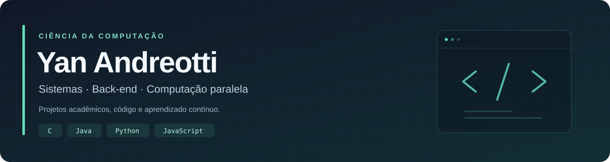

  

  Estudante de Ciência da Computação na <strong>Universidade Presbiteriana Mackenzie</strong>. 
  Construindo uma base em desenvolvimento de software, sistemas e resolução de problemas.

  <a href="#projetos-em-destaque">Projetos em destaque</a> ·
  <a href="#outras-trilhas">Outras trilhas</a> ·
  <a href="#tecnologias-nos-projetos">Tecnologias</a>

## Sobre mim

Sou **Yan Andreotti dos Santos**. Neste perfil, reúno projetos e estudos que conectam os fundamentos da computação à implementação: processos em C, estruturas de dados em Java, comunicação distribuída em Python e interfaces web.

Tenho interesse em entender como os sistemas funcionam por dentro e em documentar as decisões para que outras pessoas consigam explorar o código.

## Projetos em destaque

| Projeto | O que você encontra | Tecnologias |
| --- | --- | --- |
| [**AgroDrone**](https://github.com/yanxc76/UML-Classroom-FCI) | Modelagem de um sistema de monitoramento agrícola, com diagramas e classes de domínio | Java · UML · SQL |
| [**Simulador de memória virtual**](https://github.com/yanxc76/proj2-pagingsim-printf-socorro) | Paginação e comparação entre substituição FIFO e Clock | C · Sistemas Operacionais |
| [**Busca paralela com processos**](https://github.com/yanxc76/miniproj1-quebrasenhas-g9) | Divisão de trabalho, coordenação de workers e comunicação por arquivo | C · POSIX |
| [**Analisador de árvores binárias**](https://github.com/yanxc76/EDII-Expressoes-de-Arvores) | Construção de árvores, percurso em pré-ordem e verificação de BST e balanceamento | Java · Estruturas de dados |
| [**Landing page Starbucks**](https://github.com/yanxc76/StarBucks-projeto) | Interface de estudo com troca dinâmica de produtos e cores | HTML · CSS · JavaScript |

## Outras trilhas

- [**Computação paralela**](https://github.com/yanxc76/computacao-paralela-labs): experimentos com threads, mutexes, processos e pipes.
- [**Computação distribuída**](https://github.com/yanxc76/Computa-o-Distribuida): sockets TCP, MPI e infraestrutura Docker para laboratórios.
- [**Chamadas de sistema**](https://github.com/yanxc76/lab2-chamadas-de-sistema-yanxc76): operações de I/O em Linux e análise com strace.
- [**Desenvolvimento seguro**](https://github.com/yanxc76/ssdlc-mackenzie): oficina com Spring Boot e Vue, usando vulnerabilidades intencionais para estudo.

## Tecnologias nos projetos

**Linguagens:** C · Java · Python · JavaScript · SQL  
**Interfaces e back-end:** HTML · CSS · Vue 3 · Spring Boot  
**Ferramentas e conceitos:** Git · Linux · Docker · MPI · PlantUML · processos · concorrência

Os repositórios indicam o contexto acadêmico, os colaboradores e o estágio de cada implementação. Cada README oferece um ponto de partida para navegar pelo código e reproduzir os exemplos.

[**Explorar todos os repositórios →**](https://github.com/yanxc76?tab=repositories)

---

Computer Science student exploring systems, back-end development and parallel computing through hands-on projects.
